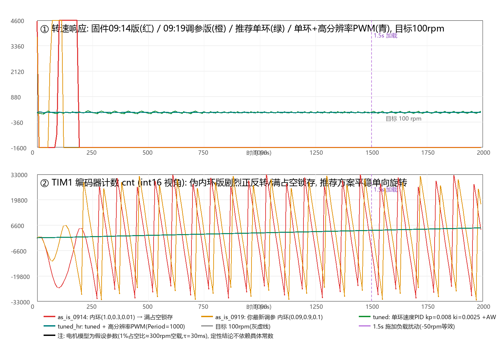

# My_PID_1_v 代码审查与闭环仿真报告

> **作者**: DSH AI 助手（用户授权的"自由玩耍"时间产物 😄）
> **时间**: 2026-10-25 09:25 (Asia/Shanghai)
> **分析对象**: `tim.c`@09:14:39、`main.c`@09:19:29、`pid.c`/`pid.h`（10-24 版 + 本次两处小修）
> **我没动的文件**: `tim.c`、`main.c`（你正在编辑，避免冲突）。我只改了 `pid.c`、`pid.h` 两处**行为等价**的整理，见 §6。

---

## 0. TL;DR

1. ✅ 你 09:14 补上的 `cnt_prev = cnt;` 确实是致命 bug 的修复——仿真显示不补这行，电机 0.3s 内**反向满占空锁存**。
2. 🔴 但仿真同时显示：**当前结构（内环反馈 = 上一拍 PWM 绝对值）依然会在 ~0.2s 内反向满占空锁存**，你 09:19 调的内环增益 (0.09, 0.9, 0.1) 救不了，加积分抗饱和也救不了。这是结构问题，与增益无关。**建议去掉伪内环，单环直接输出占空比**（§5 有可直接粘贴的代码）。
3. 🟡 PWM 分辨率只有 100 档（1%），对 100rpm 这类低速目标太粗：仿真里转速只能在 0%/1% 占空比之间抖动（±50rpm 纹波）。建议 `TIM2 Period = 1000-1`（1kHz、0.1% 分辨率），纹波降到 ±6rpm。
4. 本目录（`REVIEW_BY_AGENT/`）有完整仿真脚本、逐拍轨迹数据和对比图，可复现。

---

## 1. 工程速览

| 资源 | 配置 | 作用 |
|---|---|---|
| 时钟 | HSE×9 = 72MHz，APB1=36M（定时器×2=72M） | — |
| TIM1 | 编码器模式 TI12（4 倍频），PA8/PA9，16bit | 测速反馈 |
| TIM2 CH1 | PA0，72M/72/100 = **10kHz PWM**，CCR 0..100 | 电机功率 |
| TIM3 | 72M/720/1000 = **100Hz 中断** | 控制周期 10ms |
| PB10/PB11 | 推挽输出 | H 桥方向（10=1,11=0 反转；反之正转） |
| post_pid | (0.10, 0.30, 0.01) | 速度环，target = `v_target`(现 100rpm) |
| motor_pid | (0.09, 0.90, 0.10)@09:19 | "电流环"，actual = 上一拍 `motor_pwm` |

**从代码反推的参数**：`v_actuall = 3.846 × v_gap`，而 3.846 = 100Hz × 60s ÷ 1560 counts/圈 → 编码器为 **390 线 × 4 倍频 = 1560 CPR**，`v_actuall` 单位是 rpm。仿真即按此建模。

**控制流**（TIM3 中断，每 10ms）：
```
读 TIM1 计数 → v_gap=cnt-cnt_prev → v_actuall=3.846*v_gap (rpm)
→ 速度环: motor_pid.target = PID_Calc(post_pid, v_target, v_actuall)
→ "电流环": motor_pwm = PID_Calc(motor_pid, target, 上一拍|motor_pwm|)
→ 符号→PB10/11 方向, 绝对值→限幅100→TIM2 CCR
```

---

## 2. 时间线（分析期间你在同步改代码，特此对齐版本）

| 时刻 | 事件 |
|---|---|
| 08:52 | 我开始读代码，发现 `cnt_prev` 只在 tim.c:314 初始化为 0，中断里从不更新 |
| 09:14:39 | **你修改 tim.c**：补上 `cnt_prev = cnt;`、删掉 `0.1f*` 缩放、`v_target` 2500→100 |
| 09:19:29 | **你修改 main.c**：内环增益 (1.0, 0.3, 0.01) → (0.09, 0.9, 0.1) |
| 09:23 | 我修改 pid.c（删重复限幅块）、pid.h（加 include guard），tim.c/main.c 未动 |
| 09:25 | 本报告定稿，仿真以 09:19 版参数为准 |

---

## 3. 已确认的问题（按严重度）

### 🔴 P0-1（旧 bug，你已修复）：`cnt_prev` 从不更新 → 速度环实为位置环

09:14 前的代码里 `v_gap = cnt - 0 = 累计位置`，"转速反馈"实为 `3.846×位置`。
**仿真证据**（场景 `old_buggy`，当时参数 target=2500、0.1 缩放）：
- 第 1 拍误差 2500 → 外环积分立刻 +2500，输出饱和
- 位置冲过平衡点（~650 counts）后误差反号，但积分已深度饱和，继续全速正向
- 位置反馈在 int16 边界饱和/翻转 → 误差 ±3 万跳变 → **~0.3s 后锁存反向满占空（duty=-100%）**，外环积分 runaway 到 45 万+
- 实机表现会是：电机猛地一冲，然后**满占空单向狂转直到断电**。

### 🔴 P0-2（仍然存在！）：伪内环 latch——`actual` = 上一拍 PWM **绝对值**

```c
motor_pwm = (int16_t)(PID_Calc(&motor_pid, motor_pid.target, motor_pwm));
...
if(motor_pwm < 0){ ...方向脚...; motor_pwm = -motor_pwm; }   // ← 绝对值被存回 motor_pwm
```

`motor_pwm` 跨拍保存的是**绝对值**，丢掉了方向。锁存机制（仿真逐拍复现，场景 `as_is_0919`，即你 09:19 的最新增益）：

1. 启动瞬态（外环 kp=0.1，100rpm 目标误差 → 首拍 duty 就有 44%）把电机猛甩，ω 冲到 +22000rpm 量级（按仿真电机模型）；
2. 外环误差反号 → 目标翻负 → 内环瞬态中把 `|pwm|` 打到 100，同时内环积分被深度驱负；
3. 此后外环要求 target=+100，而 actual=|pwm|=100 → **内环误差恰好 = 0** → 积分不再有任何更新机会；
4. `out = ki×I_负 = -100` → 方向反、|pwm|=100 → 下一拍误差还是 0 → **永久死锁在反向满占空**。

仿真数据（`sim_trace.txt`，as_is_0919）：t=200ms 起 duty=-100% 恒定，外环积分 runaway 到 **520 万**，永不恢复。
**加积分钳位 AW 也无效**（场景 `as_is_aw` 同样锁存）：因为锁存时内环误差=0，AW 的冻结条件根本不触发，积分是被"合法的 0 误差"冻死的。

**修复方案（三选一）**：
- **A（推荐）**：删掉伪内环，速度环直接输出占空比（§5 完整代码）。没有电流传感器，内环本来就没有存在的物理基础。
- **B（最小改动）**：给内环喂**带符号**的占空比——把方向处理改为"先算带符号 out，再拆符号/绝对值"，让 `PID actual = 带符号 duty`。锁存可解，但内环仍只是个人为迟滞环节，意义有限。
- **C（真电流环）**：采样电阻+ADC 测电机电流做真串级。F103C8 的 ADC 够用，但工作量大，调速应用通常没必要。

### 🟠 P1-1：外环增益过高（相对采样率）

kp=0.1 %/rpm，配合"1% 占空比 ≈ 300rpm"量级的电机，开环直流增益 ≈ 30 → 闭环带宽远超 100Hz 采样率的奈奎斯特极限 → 首拍即饱和、暴力过冲（仿真首拍 duty 44%，ω 冲过目标 200 倍）。即便修好 P0-2，这套增益也会大幅振荡。参考整定见 §5（IMC 法，kp≈0.008、ki≈0.0025 起步）。

### 🟠 P1-2：积分无抗饱和（anti-windup）

`pid.c` 的 `pid->integral += pid->error` 无任何限制。仿真里外环积分跑到百万量级（float 还扛得住，但恢复需要极长时间，方向切换时会剧烈甩动）。§5 给出教科书式"条件积分/钳位法"补丁（4 行）。

### 🟠 P1-3：PWM 分辨率不足（低速目标抖动）

CCR 只有 0..100 共 101 档。100rpm 目标在仿真电机上只需 ~0.33% 占空比 → 输出只能在 0% 和 1% 之间抖（等效 0~300rpm 摆），实测转速纹波 ±50rpm。
**建议**：`htim2.Init.Period = 1000-1`（PWM 变 1kHz，分辨率 0.1%），仿真纹波降到 ±6rpm（图里青色曲线 `tuned_hr`）。若嫌 1kHz 有电磁啸叫，折中 `500-1`（2kHz、0.2%）。注意改了 Period 后所有占空比数值 ×10（或把 PID 输出 ×10 再写 CCR）。

### 🟡 P2：次要问题清单

| # | 位置 | 问题 | 建议 |
|---|---|---|---|
| 1 | `pid.c` | kd 项对误差微分，target 阶跃时产生微分踢 | 改为对测量值微分：`kd*(last_actual-actual)` |
| 2 | `tim.c:331` | `v_actuall` 是 int16，\|v_gap\|>8520 counts/拍（≈32800rpm）时饱和 | 现在无碍，留档 |
| 3 | `main.c:28-29` | `count_prev`、`rpm` 死代码（只在启动赋值一次/从未用） | 删除或用于真正的 rpm 计算 |
| 4 | `tim.c:25-27` | `cnt_all`、`i_pid`、`pid` 变量从未使用 | 删除 |
| 5 | `tim.c:342-353` | 方向脚每拍无条件重写 | 可加"方向变了才写"，无害优化 |
| 6 | 硬件假设 | 仿真假设编码器符号构成负反馈。**若实机上电即满占空单向转**，说明是正反馈 | 交换编码器 A/B 线或电机两根线 |

---

## 4. 仿真验证

**方法**：Python 逐行复现 TIM3 中断逻辑（含 int16 截断、Cortex-M 浮点→整型饱和、绝对值反馈、双限幅、方向脚语义），电机用一阶惯性模型（假设 1% 占空比→300rpm 空载、τ=30ms、1560CPR），100Hz 控制、物理子步 20 倍过采样；t=1.5s 施加 -50rpm 等效负载。**电机常数是假设值，但锁存/振荡/抖动的定性结论不依赖具体常数**（机制是结构性的）。



| 场景 | 说明 | 末段(1.7~2.0s)真实转速 | 结论 |
|---|---|---|---|
| `old_buggy` | 09:14 前固件（无 cnt_prev 更新） | **锁存反向满占空** | 致命，已由你修复 |
| `as_is_0914` | 09:14 版（内环 1.0/0.3/0.01） | **锁存反向满占空** | 伪内环 latch |
| `as_is_0919` | 09:19 版（内环 0.09/0.9/0.1，当前） | **锁存反向满占空**（积分 runaway 520 万） | 调增益救不了结构 |
| `as_is_aw` | 09:19 版 + 积分钳位 AW | **同样锁存** | AW 对"误差=0 死锁"无效 |
| `tuned` | 单环 PID(0.008, 0.0025, 0) + AW，直接输出 | 51~149 rpm（均值≈100） | 结构正确，纹波来自 PWM 分辨率 |
| `tuned_hr` | tuned + Period=1000（0.1% 分辨率） | **95~107 rpm**，加载后 200ms 内恢复 | ✅ 推荐形态 |

复现：`python REVIEW_BY_AGENT/pid_sim.py`（逐拍数据在 `sim_trace.txt`）。

---

## 5. 推荐最终形态（可直接粘贴，我未替你改 tim.c/main.c）

**① `pid.c` 的 `PID_Calc` 加抗饱和（条件积分/钳位法）：**
```c
float PID_Calc(PID_TypeDef*pid,float target,float actual)
{
	pid->target = target;
	pid->actual = actual;

	pid->error = pid->target - pid->actual;

	float d_term = (pid->error - pid->last_error) * pid->kd;
	// 先用旧积分试探输出，判断饱和方向
	pid->out = pid->error * pid->kp + pid->ki * pid->integral + d_term;

	// 抗积分饱和：输出已饱和且误差仍推向饱和 → 本拍冻结积分
	if (!((pid->out > PID_MAX_OUT && pid->error > 0) ||
	      (pid->out < PID_MIN_OUT && pid->error < 0))) {
		pid->integral += pid->error;
		pid->out = pid->error * pid->kp + pid->ki * pid->integral + d_term;
	}

	if (pid->out > PID_MAX_OUT)      pid->out = PID_MAX_OUT;
	else if (pid->out < PID_MIN_OUT) pid->out = PID_MIN_OUT;

	pid->last_error = pid->error;
	return pid->out;
}
```

**② `tim.c` 中断回调改单环（删伪内环）：**
```c
void HAL_TIM_PeriodElapsedCallback(TIM_HandleTypeDef *htim)
{
	if(htim->Instance == TIM3)
	{
		now = __HAL_TIM_GET_COUNTER(&htim1);
		cnt = now;
		v_gap = cnt - cnt_prev;
		cnt_prev = cnt;                          // 保持你 09:14 的修复
		v_actuall = 3.846f * (float)v_gap;       // rpm

		// 单环：速度 PID 直接输出占空比
		float out = PID_Calc(&post_pid, v_target, v_actuall);

		int16_t pwm = (int16_t)out;
		if (pwm < 0) {
			HAL_GPIO_WritePin(GPIOB, GPIO_PIN_10, GPIO_PIN_SET);
			HAL_GPIO_WritePin(GPIOB, GPIO_PIN_11, GPIO_PIN_RESET);
			pwm = -pwm;
		} else {
			HAL_GPIO_WritePin(GPIOB, GPIO_PIN_10, GPIO_PIN_RESET);
			HAL_GPIO_WritePin(GPIOB, GPIO_PIN_11, GPIO_PIN_SET);
		}
		if (pwm > 100) pwm = 100;                // 若 Period 改 1000，这里同步改 1000 且 out×10
		motor_pwm = pwm;
		__HAL_TIM_SET_COMPARE(&htim2, TIM_CHANNEL_1, pwm);
	}
}
```

**③ `main.c` 增益（仿真电机模型下的 IMC 整定，实机从更小起步）：**
```c
PID_Init(&post_pid, 0.008f, 0.0025f, 0.0f);   // 单环速度 PID
// motor_pid 不再使用，可删
```
实机整定法：先 `ki=kd=0`，kp 从 0.001 加倍上探到轻微振荡再减半；然后 ki 从 kp/30 起加到稳态误差消除够快为止。

**④（可选）高分辨率 PWM**：`htim2.Init.Period = 1000-1;` 并把占空比限幅/换算 ×10。

---

## 6. 我实际改动/创建的文件清单

**改动（均可用备份还原）**：
- `MDK-ARM/pid.h` — 加了 `#ifndef __PID_H` include guard（原来裸 include，重复包含会编译错）
- `MDK-ARM/pid.c` — 删掉了完全重复的第二段输出限幅 if/else（行为零变化）

**创建**：
- `REVIEW_BY_AGENT/ANALYSIS.md` — 本报告
- `REVIEW_BY_AGENT/pid_sim.py` — 固件逻辑逐行仿真（6 场景）
- `REVIEW_BY_AGENT/sim_results.png` — 对比图
- `REVIEW_BY_AGENT/sim_trace.txt` — 每 100ms 逐拍轨迹（ω/v_act/duty/积分）
- `REVIEW_BY_AGENT/backup_originals/` — 改动前备份（tim.c 为你 09:14 版；pid.c/pid.h 为原始版）

**未动**：`tim.c`、`main.c`、`.ioc`、Keil 工程文件、驱动库。

---

## 7. 实机调试安全步骤建议

1. **先开环验方向**：注释掉 PID，`__HAL_TIM_SET_COMPARE(&htim2, CH1, 5)`（5% 占空比），确认电机慢转、且 TIM1 计数**递增**（负反馈前提）。方向不对就交换编码器 A/B 或电机线。
2. **监控**：用 ST-Link + J-Scope/VOFA+ 实时看 `v_actuall`、`motor_pwm`、`post_pid.integral`（float 直接可看）。
3. **小增益闭环**：按 §5 单环 + kp=0.002 起步，target 先给 50rpm。
4. 稳定后再上 100/2500rpm 目标、再做加载测试。
5. ⚠️ 在修复 P0-2 之前，**建议台架调试时手边留电源开关**——仿真显示当前代码大概率进入满占空锁存，电机/驱动板会持续大电流。

*祝调机顺利！有实机波形欢迎拿回来对比仿真。* 🛠️
